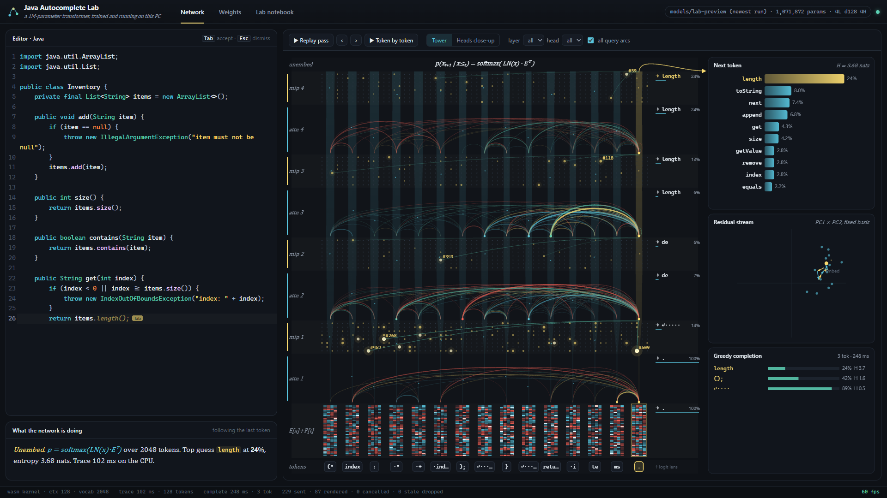
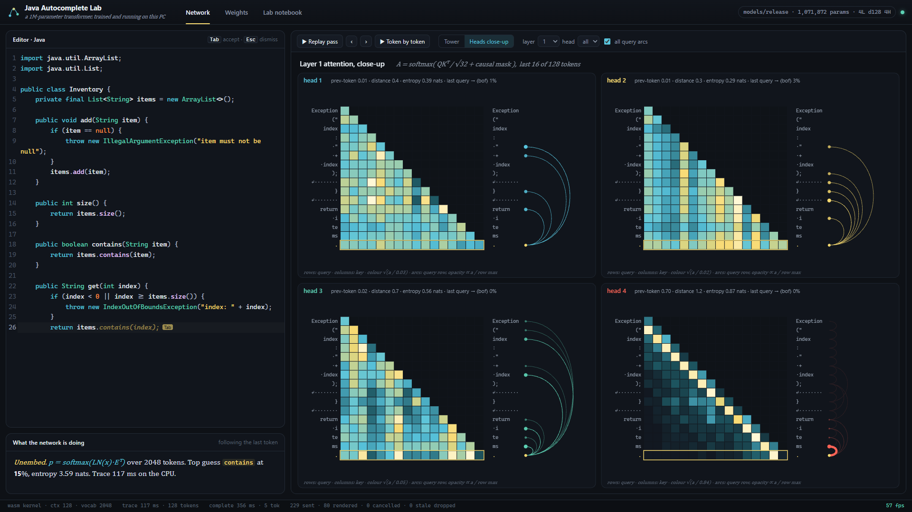
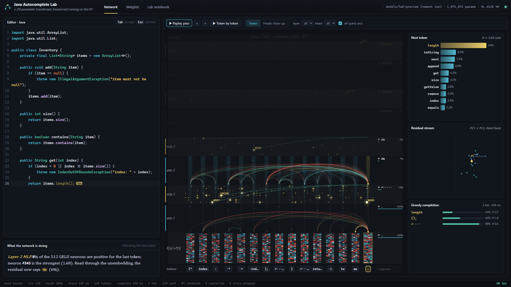
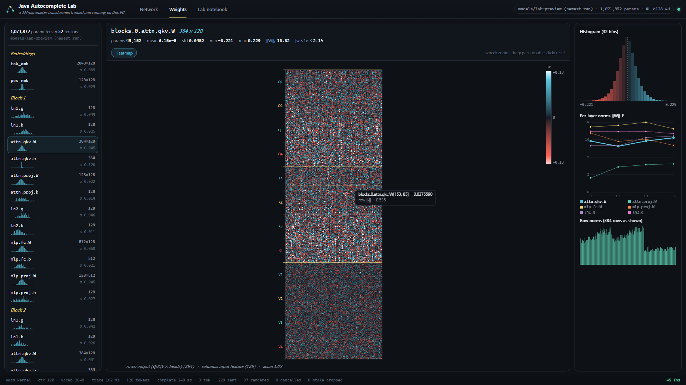
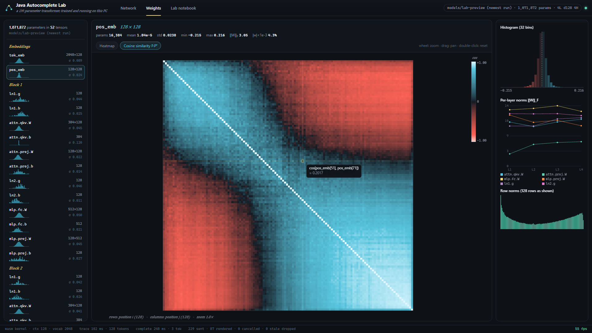
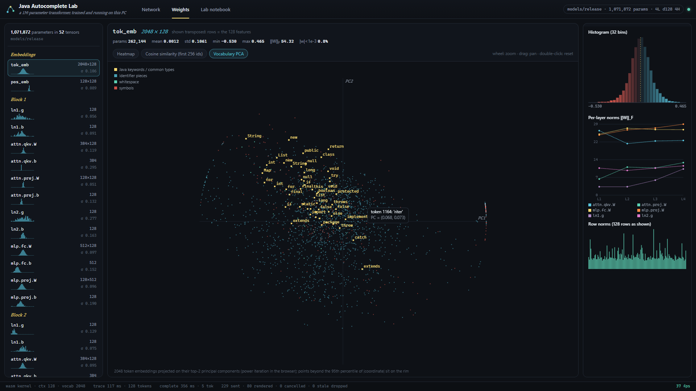
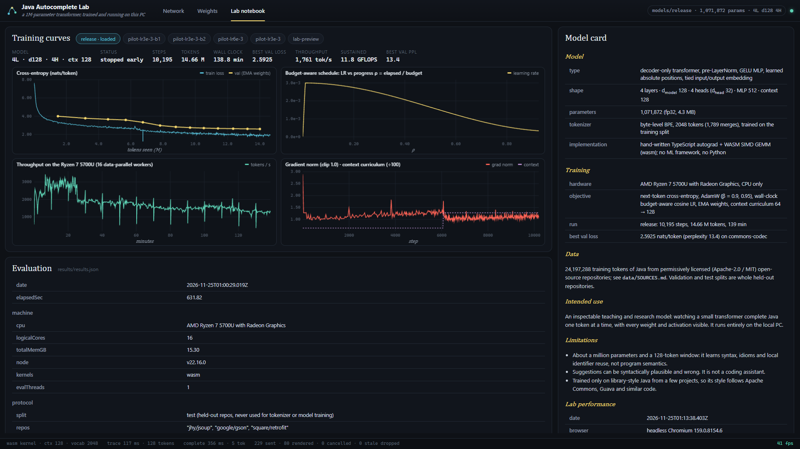

# Java Autocomplete Lab: a tiny code-completion transformer trained on a laptop CPU, in pure TypeScript

Java Autocomplete Lab is a 1.07M-parameter decoder-only transformer that completes Java code.
Everything was written from scratch in TypeScript: the tensor/autograd engine (with a hand-assembled WASM SIMD
matrix kernel), the byte-level BPE tokenizer, the data-parallel trainer and the inference server. No ML
framework and no Python are involved. The release model was trained for about 130 minutes on an AMD Ryzen 7 5700U
laptop (8 cores, 16 GB RAM, no discrete GPU) and runs on the same machine. The web lab is styled after
3Blue1Brown. You type Java, and it shows the real forward pass for each keystroke: token embeddings, attention
arcs per head, all 512 GELU neurons of every layer, the residual stream, a logit lens and the softmax over the next
token. A browser for every weight tensor is included. On held-out repositories the network beats an interpolated
Kneser-Ney 5-gram on every metric: **49.5% top-1 next-token accuracy against 35.5%**, perplexity 12.9 against 32.8,
with 4.3 MB of weights against 168 MB of n-gram tables. A file-level cache n-gram still beats it on token metrics;
see [Findings](#findings).



## Quick start

Requires Node.js 22 or newer. The trained weights (`models/release/`, 4.3 MB) and the tokenizer are part of the
repository, so you can run the lab without downloading data or training anything.

```bash
npm install
npm run build        # type-checks server + web app, builds web/dist
npm start            # serves the lab and the API on http://127.0.0.1:5177
```

Then open **http://127.0.0.1:5177**. The lab has three tabs:

* **Network**: type in the editor on the left. Each keystroke sends a trace request over a WebSocket. The server
  runs a real forward pass on the CPU (about 90 ms), and the tower redraws, bottom to top. When you pause, a
  greedy rest-of-line completion appears as ghost text (<kbd>Tab</kbd> accepts it, <kbd>Esc</kbd> dismisses it).
  *Replay pass* animates the computation stage by stage, *Token by token* steps through the window, and *Heads
  close-up* shows the full attention matrices.
* **Weights**: every tensor as a zoomable diverging heatmap with exact values on hover, plus histograms, per-layer
  norms, the cosine similarity of the position embeddings and a PCA of the vocabulary embeddings.
* **Lab notebook**: training curves from `models/*/log.jsonl`, the evaluation tables, the model-size benchmark,
  the corpus and a model card.

Development mode: `npm start` in one terminal and `npm run dev:web` in another (Vite on :5178, proxying to :5177).
`npm test` runs the 63 unit tests: gradient checks for every op, WASM-vs-JS kernels, tokenizer round-trips, the
trainer, the n-gram baseline and the server.

### Rebuild the corpus and retrain

```bash
npm run corpus       # shallow-clones the 22 Apache-2.0 / MIT repos into data/raw, cleans + splits by repo
npm run tokenizer    # byte-level BPE (vocab 2048) on the train split; writes data/{train,val,test}.bin
npm run bench        # optional: kernel GFLOPS + tokens/s per model size -> results/bench.json (~5 min)
npm run train -- --run my-run --budget-min 150 --preset base --workers 16 --batch 1 --lr 3e-3
```

`data/` is gitignored. It holds about 295 MB of raw clones, 89 MB of cleaned Java and 53 MB of token files. Training writes
`models/my-run/{config.json, weights.bin, log.jsonl, summary.json}`. `weights.bin` holds the best EMA weights on
the validation repo. The budget is wall-clock time, so a 20-minute run and a 3-hour run both end with a fully
annealed model (`--budget-min 20` works). The server loads `models/release` if it exists, otherwise the newest
run; `npm start -- --model models/my-run` picks one explicitly.

Caveat: `npm run corpus` clones each repository's *current* HEAD. The commits used for the shipped model are listed
in [`data/SOURCES.md`](data/SOURCES.md). A fresh corpus can therefore differ slightly, and re-running
`npm run tokenizer` overwrites `models/tokenizer.json`. The shipped weights only work with the shipped tokenizer
(`git checkout models/tokenizer.json` restores it).

### Evaluate

```bash
npm run evaluate                                   # models/release vs the n-gram baselines, test repos only
npm run evaluate -- --models models/release,models/my-run --windows 2700 --lines 500 --order 5 --seed 2026
```

This writes `results/results.json` and `results/results.md`, and records the sha256 of every evaluated
`weights.bin` so that each number can be traced to exact bytes. The full evaluation takes about 10 minutes on one
thread. `npm run screenshots` (after `npx playwright install chromium`) drives the built lab in headless Chromium,
types real Java, refreshes `docs/screenshots/` and records the frame rate to `results/web-perf.json`.

## How it works

| Part | What it is | Where |
|---|---|---|
| **Engine** | Float32 tensors with reverse-mode autograd: matmul, LayerNorm, GELU, causal softmax attention, fused cross-entropy, AdamW. The matmul kernel is hand-written WASM SIMD (8.4 to 9.6 GFLOPS on one thread at the model's layer shapes, 5 to 7x the best plain-JS kernel). Every op is gradient-checked against finite differences | `src/engine/` |
| **Tokenizer** | Byte-level BPE with 2048 tokens (1,789 merges), trained on the train split only. Java-aware pre-tokenisation keeps merges from crossing identifier, operator or whitespace boundaries (TokDrift). Each file is wrapped in `<\|bof\|>` and `<\|eof\|>`. All 13,016 files round-trip exactly. 3.36 bytes per token on train, 3.08 on test | `src/tokenizer/` |
| **Model** | GPT-style decoder: 4 layers, d<sub>model</sub> 128, 4 heads of 32, GELU MLP of 512, context 128, pre-LayerNorm, learned absolute positions and tied input/output embeddings. 1,071,872 parameters (4.3 MB fp32). The size came from `npm run bench`: the largest candidate that sees at least 10 tokens per parameter in 150 minutes | `src/model/` |
| **Training** | Data-parallel across `worker_threads`, with a gradient all-reduce, clipping at 1.0, AdamW (β 0.9/0.95, weight decay 0.1) and EMA weights (0.999). Progress ρ = elapsed / budget drives everything: warmup, then cosine LR decay to 10% of peak, and a context curriculum that trains at 64 tokens until ρ = 0.3 and at 128 after. Validation runs every 10 minutes on commons-codec, and the best EMA checkpoint is kept | `src/train/`, `scripts/train.ts` |
| **Inference and tracing** | A Node HTTP + WebSocket server. One traced forward pass records token ids, embeddings, every head's attention matrix, all MLP activations, residual norms per stage, a logit lens per stage and a 2-D projection of the residual stream on a PCA basis that is fit once at load. Requests are debounced for 60 ms per connection, and a newer keystroke cancels an older pass. Completions use a KV-cached incremental decoder (16 tokens in 235 ms instead of 1389 ms with full recompute) | `src/server/`, [`docs/SERVER.md`](docs/SERVER.md) |
| **Web lab** | Vite + TypeScript, Canvas2D and CodeMirror 6, with no UI framework. Every lit cell, arc and dot is a value from the trace or from the raw weight tensors. Measured at a median of 60 fps while typing (headless Chromium, GPU raster) | `web/`, [`docs/WEB.md`](docs/WEB.md) |

Design records: [`docs/SPEC.md`](docs/SPEC.md) (the specification), [`docs/DECISIONS.md`](docs/DECISIONS.md)
(about 60 numbered decisions, each with its reason or measurement), [`docs/survey.md`](docs/survey.md) (paper
survey) and [`docs/RESEARCH_STANDARD.md`](docs/RESEARCH_STANDARD.md) (the TinyMind standard this project follows).

## The papers it draws on

| Paper | What this project takes from it |
|---|---|
| Attention Is All You Need (arXiv:1706.03762) | Decoder-only transformer blocks and scaled dot-product attention |
| TinyStories (arXiv:2305.07759) | Evidence that 1 to 10M-parameter transformers become fluent in a *narrow* domain; Java is narrow and regular |
| Neural Machine Translation of Rare Words with Subword Units (arXiv:1508.07909); Code Completion using Neural Attention and BPE (arXiv:2004.06343) | Byte-level BPE solves the open vocabulary of code identifiers |
| TokDrift (arXiv:2510.14972) | Subword boundaries that cross grammar boundaries hurt code models, hence Java-aware pre-tokenisation |
| Using the Output Embedding to Improve Language Models (arXiv:1608.05859) | Tied embeddings; at vocab 2048 × d 128 the embedding is about 25% of the parameters |
| Chinchilla (arXiv:2203.15556); Scaling Laws for Neural LMs (arXiv:2001.08361) | Splitting a fixed FLOP budget between parameters and tokens; picking the release config from short pilot runs |
| Cramming (arXiv:2212.14034) | A fixed wall-clock budget with the LR schedule tied to it; pre-LN; no dropout |
| AdamW (arXiv:1711.05101); GELU (arXiv:1606.08415) | Optimizer; one activation per neuron, so "neurons lighting up" is meaningful (SwiGLU was rejected for that reason) |
| Transformer Explainer (arXiv:2408.04619); AttentionViz (arXiv:2305.03210) | UI prior art: stage-by-stage forward-pass playback, per-head attention colours and arcs |
| In-context Learning and Induction Heads (arXiv:2209.11895); Elhage et al. 2021, *A Mathematical Framework for Transformer Circuits*; nostalgebraist 2020, *the logit lens* | The residual-stream, attention-head and logit-lens views |
| IntelliCode Compose (arXiv:2005.08025); CodeXGLUE (arXiv:2102.04664) | Line-completion metrics: exact match and edit similarity |
| Kneser & Ney 1995; Chen & Goodman 1998; Hindle et al. 2012, *On the Naturalness of Software*; Tu et al. 2014; Hellendoorn & Devanbu 2017, *Are deep neural networks the best choice for modeling source code?* | The n-gram baselines, including the cache n-gram, which is known to be a strong code model |

Also considered and not used, with reasons in the survey: RoPE, SwiGLU, RMSNorm, fill-in-the-middle, retrieval and
long-context completion.

## Results

Headline: top-1 next-token accuracy of 49.5% for the network against 35.5% for the 5-gram Kneser-Ney baseline.

All numbers are measured on three **held-out repositories** (jhy/jsoup, google/gson, square/retrofit: 709 files and
1.68M tokens). The tokenizer and the trainer never saw them. Next-token metrics score 259,200 target positions
(2,700 windows of 128 tokens, positions with at least 32 tokens of context). Every method predicts exactly the same
tokens. Line completion uses 500 seeded random lines cut at a random token boundary, with greedy decoding until
the newline. Baselines are built from the same 24.2M train tokens the network saw.

| Method | Size | Top-1 | Top-5 | Perplexity | Line exact match | Line edit sim | ms / completion |
|---|---|---|---|---|---|---|---|
| **transformer (release)** | 1.07M params, 4.3 MB | **49.5%** | **70.1%** | **12.89** | **19.4%** | **0.427** | 81 (p95 168) |
| transformer after 22 min (preview) | 1.07M params, 4.3 MB | 29.8% | 51.4% | 40.87 | 12.6% | 0.302 | 84 |
| 5-gram Kneser-Ney | 168 MB | 35.5% | 57.7% | 32.83 | 11.4% | 0.300 | 1.2 |
| 5-gram KN + window cache (sees the same 128 tokens) | 168 MB | 45.9% | 66.7% | 18.96 | 14.0% | 0.334 | 1.6 |
| 5-gram KN + file cache (up to 2048 tokens back) | 168 MB | *58.2%* | *77.7%* | *9.10* | *19.6%* | 0.403 | 1.5 |
| most-frequent token | 0 | 4.5% | 10.7% | 662.6 | 0.0% | 0.013 | 0.0 |

On the same 500 lines, against the plain 5-gram: both are exact on 45, only the network on 52, only the n-gram on 12
and neither on 391 (exact sign test p = 4.6e-7). Top-1 per test repo: jsoup 45.4%, gson 52.5%, retrofit 53.8%.

Training run: 1.07M parameters, 16 worker threads, a 150-minute budget, peak LR 3e-3 and 2048 tokens per step. The
shipped checkpoint is the trainer's best-on-validation EMA checkpoint, from step 9,875 at 130.3 minutes, after
14.0M tokens (13.1 tokens/parameter), with validation loss 2.593 nats on commons-codec. Weights sha256
`d91725ce74defe8167bca25e692b043797b69717fe0a4a4a9cca8169406c77b2`.

Full tables (by token class, by line kind, pilots, the n-gram build and examples): [`results/results.md`](results/results.md).
Raw numbers: `results/results.json`.

## Findings

* **The network beats the classic baseline at 1/40th of its size.** Against an interpolated modified Kneser-Ney
  5-gram it gains 14 points of top-1 accuracy, has 2.5x lower perplexity and wins line exact match 19.4% to 11.4%.
  It also wins like-for-like against a cache n-gram that sees only the network's 128-token window (45.9% top-1).
* **Negative result: a file-level cache n-gram beats it on token metrics.** Given up to 2048 earlier tokens of
  the same file (Tu et al. 2014; Hellendoorn & Devanbu 2017), the n-gram reaches 58.2% top-1 and perplexity 9.1.
  Line exact match is a tie (19.6% against 19.4%, one line in 500), and the network has the better edit similarity.
  The gap is in identifiers (57.5% against 42.6%) and literals, which recur in a file beyond the network's 128-token
  window. The network wins on syntax and layout (whitespace 68.0% against 56.8%). A longer context or a
  network + cache mixture is the obvious next step. Neither was tried.
* **Compute moved the needle more than anything else.** After 22 minutes (2.6M tokens) the same model is *below*
  the plain 5-gram (29.8% top-1). After 130 minutes it is 19.7 points better.
* **Training was step-limited, not data-limited.** In 6-minute pilots a peak LR of 6e-3 stalled (val 5.84 against
  5.15 at 3e-3). At 3e-3, shrinking the global batch from 8192 to 4096 to 2048 tokens per step lowered the val
  loss from 5.15 to 4.42 to 4.25 at the same throughput, so the release run used one sequence per worker.
* **jsoup is the hardest repo for every method** (45.4% top-1 against 52 to 54% on the others). A plausible reason,
  not tested: gson and retrofit have relatives in the training set (jackson, okhttp), and jsoup's HTML parser has
  none.
* **Comments are harder than code.** The network's exact match is 10.8% on comment lines against 20.7% on code lines.
  On comments it trails the n-grams slightly (n = 65, so the gap is one or two lines).
* **Validation and test agree.** The best validation loss (2.593 nats) matches the test perplexity (ln 12.89 =
  2.56 nats), so checkpoint selection did not overfit the validation repo.
* **Disclosed gap in the training record.** The 150-minute run never wrote its end-of-run record. Its log survives
  to 138.8 minutes, and the process was gone when it was checked; the cause was not observed. The shipped weights
  are the checkpoint the trainer itself wrote at 130.3 minutes, and only one more scheduled validation (around
  140 minutes) could have replaced it. Every result above was re-measured on exactly those bytes. Details are in
  `models/release/summary.json`.

## Screenshots

All screenshots show the shipped `models/release` checkpoint and were taken by `npm run screenshots` (headless Chromium).

| | |
|---|---|
|  |  |
| Heads close-up: every head's attention matrix | Replay pass, mid-animation |
|  |  |
| Weights browser: a QKV matrix | Position-embedding cosine similarity |
|  |  |
| Vocabulary embedding PCA | Lab notebook: curves, evaluation, model card |

## Hardware notes

* **Machine:** AMD Ryzen 7 5700U (8 cores / 16 threads, Zen 2), 16 GB RAM, Windows 11 and Node 22. Training and
  inference use the CPU only; the integrated Vega GPU is used only by the browser to draw the lab.
* **Kernels:** single-thread GEMM runs at 1.3 to 1.6 GFLOPS in plain JS and 7.2 to 9.6 GFLOPS with the WASM SIMD
  kernel. End-to-end training throughput for the base model rose from 679 tok/s on 1 worker to 3,742 on 8 and
  4,446 on 16 (batch 8 per worker, `results/bench.json`).
* **Contention:** the laptop was shared with other heavy jobs throughout. The benchmark, the release run (1,761 tok/s
  on average, evaluation included, against 2,660 tok/s in the benchmark) and the latency measurement (taken with
  about 14.6 of 16 logical cores busy with other processes) were all affected. Treat the 81 ms per completion as an
  upper bound; an idle machine should be faster.
* **Footprint:** the network is 4.3 MB of fp32 weights. The 5-gram baseline's tables take 168 MB in memory and are
  built in about 63 s at evaluation time.

## Layout

```
src/engine/        tensors, autograd ops, AdamW, WASM SIMD GEMM, gradient checks
src/tokenizer/     Java-aware pre-tokeniser + byte-level BPE
src/model/         transformer, configs/presets, checkpoint format (config.json + weights.bin)
src/train/         budget-aware data-parallel trainer, LR/context schedules, worker threads
src/corpus/        licence detection, cleaning and de-duplication rules
src/eval/          interpolated modified Kneser-Ney n-gram (+ cache variants)
src/server/        HTTP + WebSocket server, traced forward pass, KV-cached decoder, PCA, notebook API
web/               the lab: Network / Weights / Lab notebook views (Vite + TS + Canvas2D + CodeMirror 6)
scripts/           corpus, tokenizer, bench, train, evaluate, smoke and screenshots CLIs
models/release/    the trained model: config.json, weights.bin, log.jsonl, summary.json
models/tokenizer.json
results/           results.md / results.json (evaluation), findings.md, bench.json, pilots.json, web-perf.json
docs/              SPEC, DECISIONS, survey, SERVER, WEB, RESEARCH_STANDARD, screenshots/
data/              corpus and token files (gitignored; SOURCES.md is committed)
```

## Data and licences

The code in this repository is MIT licensed (see [`LICENSE`](LICENSE)). The model was trained on 22 public Java
repositories, each licensed **Apache-2.0** or **MIT**. Each licence was verified from the repository's own
`LICENSE` file by `npm run corpus`, not assumed. The splits are 18 training repos (Apache Commons, Guava, Guice,
Jackson, RxJava, Mockito, Joda-Time, TheAlgorithms/Java, slf4j, OkHttp, JavaPoet), validation on commons-codec and
test on jsoup, gson and retrofit. junit4 was rejected for its EPL licence. Licence and copyright headers are
stripped during cleaning. **No third-party source code is redistributed here**: `data/` is gitignored and is
re-created by the scripts. [`data/SOURCES.md`](data/SOURCES.md) lists every repository, its licence, the exact
commit, the split, the cleaning rules and the drop statistics.
