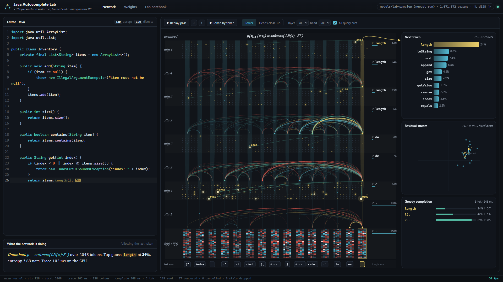
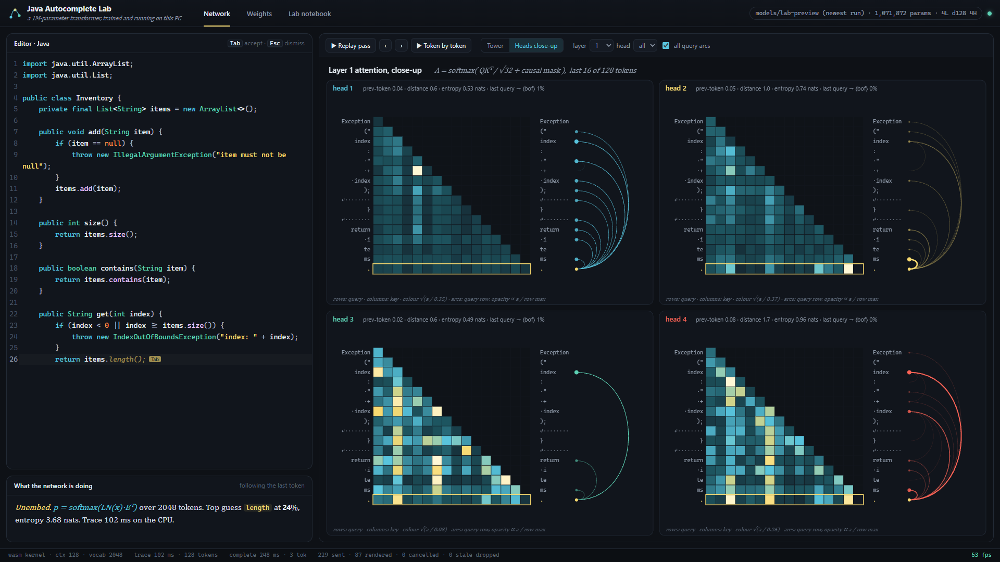
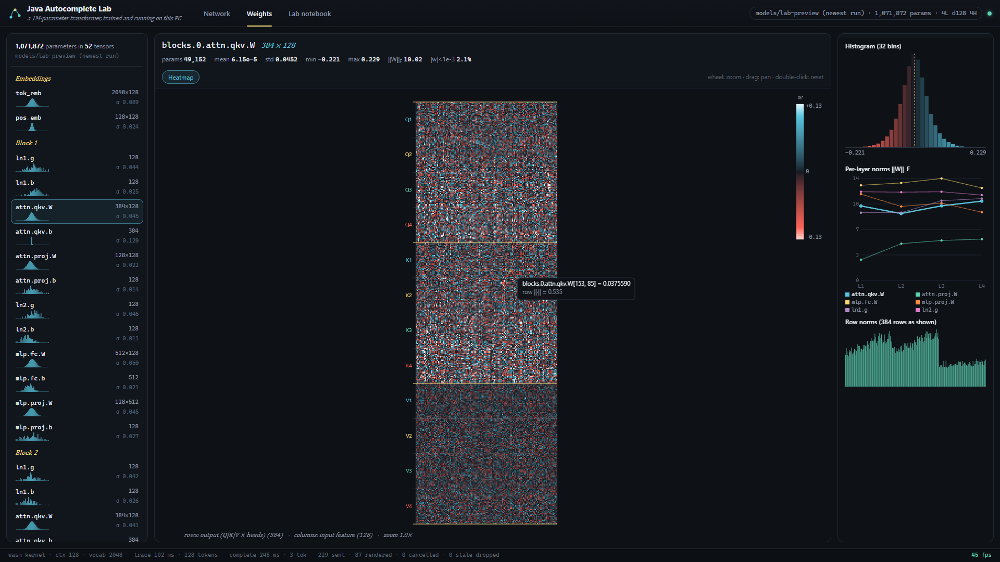
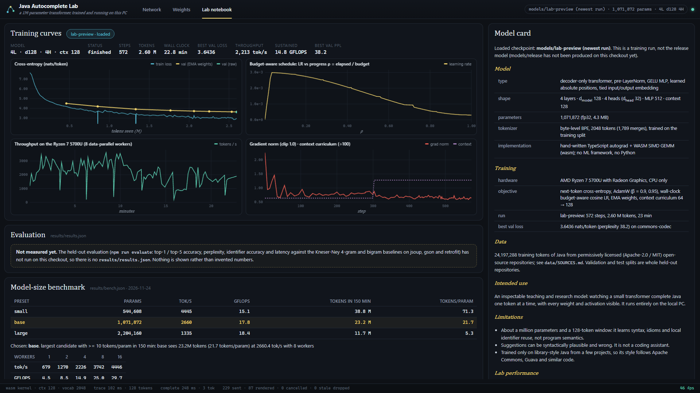

# The web lab (`web/`)

Vite + TypeScript, Canvas2D, CodeMirror 6. No UI framework. `npm run build` type-checks the server and the web app and
builds `web/dist`, which `npm start` serves at http://127.0.0.1:5177. For development, run `npm start` and
`npm run dev:web` (Vite on :5178 proxies `/api` and the trace WebSocket to the server).

Everything drawn comes from the PC-resident model: the WS trace of a real forward pass (`/api/trace`), the real weight
tensors (`/api/weights`), real completions (`/api/complete`) and the files the training scripts wrote (`/api/notebook`).

## Network tab

On every keystroke the editor sends `{type:"trace", maxTokens:0}` over the WebSocket. The server debounces it (60 ms)
and the latest request wins: a newer keystroke cancels an older pass. The client renders a trace only if it is newer
than the last one rendered, so out-of-order frames are dropped and the view is never more than one forward pass behind
the keyboard (DECISIONS D55). About 110 ms after typing stops, the editor calls `POST /api/complete`. A newer keystroke aborts that
fetch, and the server stops generating as soon as the connection drops. The completion appears as ghost text
(<kbd>Tab</kbd> accepts it, <kbd>Esc</kbd> dismisses it).

The **tower** is read from bottom to top, the way the residual stream flows:

| Row | What it shows | Source |
|---|---|---|
| tokens | the last 8-16 tokens before the cursor (whitespace made visible). Hovering a chip highlights its characters in the editor. Clicking one makes it the query. | `tokens` message |
| E[x]+P[t] | each token's 128-d input vector as a 4×32 column of cells (blue is positive, red is negative) | `tok_emb[id] + pos_emb[t]`, computed in the browser from the raw tensors |
| attn ℓ | curved arcs from the query token back to every key. Opacity and width show the attention probability, colour shows the head. Faint arcs show every other query in the window. | `attention.last`, `attention.matrices` |
| mlp ℓ | all 512 GELU neurons of the query token as a dot grid. Dots light up with their activation, and the 3 strongest send a teal line back into the token's stream. | `mlp.lastAll` (last token), `mlp.windowTop` (other tokens) |
| river | a band behind each token whose width is the residual-stream L2 norm at every stage | `norms` |
| logit lens | right gutter: the last token's residual after each stage, decoded through `ln_f` and the tied unembedding | `logitLens` |
| output | the arrow into the **softmax** panel, which shows the top-10 next tokens. Each bar is keyed by token id, so it slides to its new rank. | `next.topk` |

The right column also shows the **residual stream in PCA space** (a fixed basis fitted once at server start). The query
token's path through the layers draws on as arrows. Below that is the **greedy completion**, one row per generated token
with its probability and entropy.

Every value is tweened: new traces interpolate from the displayed state with ease-in-out cubic over 300–650 ms, and nothing
snaps. A glow sweeps up the tower on each new pass.

**Replay pass** steps through tokens → embed → attn 1 → mlp 1 → … → unembed at 0.9 s per stage. Rows above the current
stage are dimmed and arcs draw themselves on. The caption under the editor narrates each stage with numbers from this
trace, for example "Head 2 puts 61% of its weight on '(' (3 tokens back)". The ‹ › buttons step one stage at a time.
**Token by token** moves the query along the window, so the arcs, neurons and PCA path follow it.

**Heads close-up** shows one layer with a panel per head. Each panel has the arcs for the query, the full 16×16 causal
attention matrix with token labels, and per-head statistics measured on this trace: previous-token score, mean
attention distance, entropy, and the weight on `⟨bof⟩`. Hovering a cell gives the exact value. Clicking a row makes it
the query.

## Weights tab

The tab lists every tensor, grouped by block, with its shape, a histogram sparkline and its σ. The selected tensor is
drawn at full resolution from the raw Float32 data (`?format=bin`) with a diverging colormap scaled to the 99th
percentile of |w|. Very tall matrices such as `tok_emb` (2048×128) are shown transposed, and the readout accounts for
this.

- Wheel zooms at the cursor, drag pans, and double-click resets the view. When cells get large, grid lines appear, and
  past about 34 px per cell the values are printed in the cells.
- Hovering shows the exact `W[i,j]` (for `tok_emb`, together with the token string) and the row norm.
- `attn.qkv.W` gets Q/K/V × head separators.
- Lenses: `pos_emb` cosine similarity (P·Pᵀ), and a vocabulary PCA of `tok_emb` computed in the browser by power
  iteration, with Java keywords labelled.
- The side panel shows a large histogram, the per-layer Frobenius norms of each kind of weight, and the row-norm profile
  of the selected matrix.

## Lab notebook tab

- **Training curves** come from `models/<run>/log.jsonl` (every run, with the loaded one first). They show train loss
  and validation loss (EMA and raw weights) against tokens seen, the budget-aware LR against ρ, throughput, and the
  gradient norm with the context curriculum.
- **Evaluation** comes from `results/results.json`. If that file does not exist, the tab says the evaluation has not
  been run and shows no numbers.
- **Model-size benchmark** (`results/bench.json`) and **corpus** (`results/corpus-stats.json`, with the held-out repos).
- **Model card**: `MODEL_CARD.md` next to the loaded checkpoint if it exists. Otherwise the card is generated from the
  config and the measured numbers.

## Screenshots and measured frame rate

`npm run screenshots` (after `npm run build`) starts the server on a free port and opens headless Chromium at 1920×1080
and 1366×768. It types Java into the editor and saves the PNGs in `docs/screenshots/`. It also writes
`results/web-perf.json`: the frame rate measured while typing, how many trace requests were sent, rendered, cancelled by
the server and dropped as stale, and the last completion. Last run (GPU raster through ANGLE/D3D11, other jobs loading the CPU): 226 keystrokes, 88
traces rendered, 138 superseded before they were computed, and a median of 49 fps while typing (minimum 6 fps, in a
one-second window while the CPU was loaded). In a separate profile, the scene held about 60 fps while animating and 60 fps
idle with GPU raster. Headless software rendering (SwiftShader) managed 28 fps animating and 50 fps idle
(DECISIONS D59).
